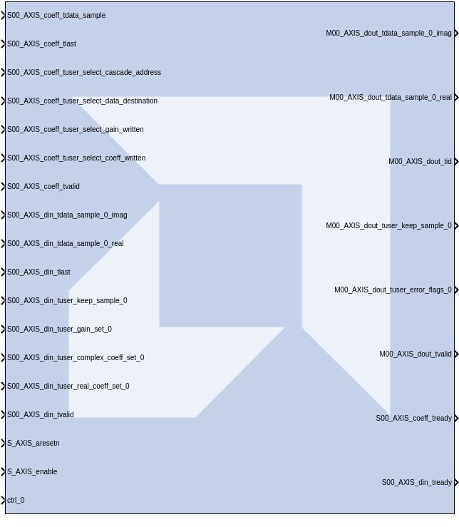

# Versal RF Channelizer

The Versal RF Channelizer block simulates the hardened Channelizer IP block from Versal RF devices.



**This block is provided as Early Access functionality in 2026.2 for the purpose of gathering customer feedback. For more information, refer to the [Versal RF Series Tools Early Access Secure Site](https://account.amd.com/en/member/versal-rf-tools-ea.html).**

## Upgrading from version 1.1 or 1.2 to version 2.0

When you open a model that still contains a legacy Versal RF Channelizer
block (version 1.1 or 1.2), Vitis Model Composer highlights the block and
reports a warning in the Diagnostic Viewer. It also generates an HTML
upgrade plan that you can review for details.

The Diagnostic Viewer includes the command to upgrade the block to
version 2.0. In the example below, `<model>` is the name of the model:

``` pre
r = xmcUpgradeIpBlocks('<model>', 'apply', ...
    'ReportFile', '<model>_xmc_upgrade_result.html', 'SaveModel', false);
```

This command replaces each legacy block with the version 2.0 library
block and copies compatible mask settings. Ports are left disconnected
so you can rewire them for the updated interface. Some ports from earlier
versions, such as `TLAST` and `keep_sample`, are removed in version 2.0.

To reconnect retained ports automatically, upgrade the model that still
contains the legacy block with the `SnapshotFile` option enabled, then
run `xmcUpgradeReconnect`. For details, enter `help xmcUpgradeReconnect`
at the MATLAB command prompt.

--------------
Copyright (C) 2026 Advanced Micro Devices, Inc.
All rights reserved.

SPDX-License-Identifier: MIT
